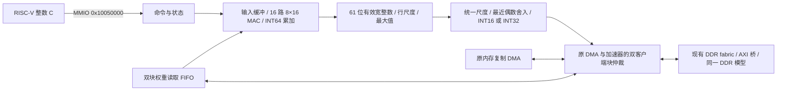

# SoC 系统学习

> 写作约束：[skills/regulation.md](../../../skills/regulation.md)。本文是当前实现的摘要，细节以源码和对应测试为准。

## 1. 从 Core 到 SoC 的层次

`CORE_BACKEND=scoreboard` 选择新双发射 Core 与 `scoreboard_soc_memory`：
IF64、D0/D1、DMA 分别持有事务；两块 64 KiB TCM 各用两个交错 bank，
TCM 响应反压存入客户端缓冲，其他客户端仍可访问 RAM。原生 I$ 命中 II=1，
两个 D$ bank 按缓存行分区并共享外部 DDR 带宽。D$ 总容量和软件维护契约保留，
维护命令须等待两个 bank 完成。测试与当前边界见 [双发射学习](DUAL_ISSUE.md)。
`LOCAL_TCM_ENABLE` 仅选择 legacy 的两种接线；新后端固定使用上述原生 bank 路由。
`555453f` 起，D0/D1 在 SoC 地址解码前各有两项请求缓冲，ready 只依赖寄存容量，
每笔请求增加一拍，稳态各口仍可每拍接受。已接纳的取消读继续外发并排空，
标签由 LSQ 保持；Store/MMIO 的队头授权在进入缓冲之前完成。

下面的单 D 口框图与 local0/local1 时序说明保留为 legacy 控制组说明。

```text
Core I 口 ── I$ / uncached ── I router ─┐
Core D 口 ── D$ / uncached ── D router ─┼─ 热路：local TCM fabric ─ ITCM / DTCM
DMA 窄口 ──────────────────── DMA router ┘
                    各 router 的慢口
                           ↓
                  主端事务寄存槽
                           ↓
                  shared per-target fabric
                  ├─ ROM / error slave
                  ├─ 每个设备请求槽 → MMIO 响应寄存器
                  └─ DDR 请求寄存槽 → DDR 仲裁/桥
DMA 256 位块口 ─────────────────────────────┘
```

- `vsrc/core/`：可移植 Core。
- `vsrc/pkg/`：类型、地址、配置、总线包。
- `vsrc/soc/`：Cache、总线、TCM、ROM、DMA、外设。
- `vsrc/cpu/`：FPGA wrapper、Pango DDR 桥。
- `vsrc/sim_cpu/`：仿真存储模型。

三主端 I/D/DMA 可以同时访问不同目标。每个目标有 owner，同一目标同一时间只接一笔。
主端 ready 不能组合穿透到另一个主端。

## 2. 总线契约

`bus_types_pkg::bus_req_t` 包含地址、读写、大小、写数据、strobe、execute 等字段；
`bus_rsp_t` 包含读数据、错误码、响应。关键规则：

1. `valid && ready` 是接受沿；接受后的请求归下游 owner，不能靠清 valid 撤销。
2. 响应必须按接受时的 owner 返回，不能按当前地址猜。
3. 已展示的 valid 在反压时保持载荷。
4. 错误分为 BUS_OK、BUS_DECERR、BUS_SLVERR；未映射窗口返回 DECERR，权限/大小
   错误返回 SLVERR。
5. Cache 维护、FENCE.I、DMA 和普通访问对同一地址的所有权必须分开处理。

详细接口见 `vsrc/pkg/bus_types_pkg.sv`、`vsrc/soc/bus/bus_interconnect.sv`、
`vsrc/soc/common/bus_transaction_register.sv`。

## 3. 地址与存储

- ITCM：64 KiB，`soc_addr_pkg::ITCM_BASE`，同步读、byte 写。
- DTCM：64 KiB，`soc_addr_pkg::DTCM_BASE`。
- Boot ROM、错误从机、UART/Timer/GPIO/DMA/系统信息等 MMIO。
- DDR：`soc_addr_pkg::DDR_BASE`，容量由 `DDR_BYTES` 参数决定。
- `address_decode` 并行产生互斥窗口命中，保留完整范围、对齐、写权限、MMIO
  word-only 和未映射错误优先级。

`LOCAL_TCM_ENABLE=1` 时，合法 TCM 请求走 hot 路，不经过慢 fabric；`0` 时 TCM
也在慢 fabric 后。两种接线共用同一份物理 TCM RAM。热路仍有本主端 owner 和响应 FF，
不是 1 拍专用口。

## 4. Cache

- I$：2 路、4 KiB、32 B 行，只缓存合法 DDR 取指；TCM/ROM/MMIO 旁路。
- D$：2 路、4 KiB、32 B 行，WB/WA；只覆盖 DDR，MMIO/TCM 旁路。
- 命中路径是 IDLE→LOOKUP→RESPOND；load 命中 II=3，store 命中多一拍。
- miss 先探测 victim，脏行完整写回后才填行；填行成功才安装。
- 填行/写回可走 256 位块口（`CACHE_BLOCK_ENABLE=1`），但 RAM 仍逐 word 写。
- FENCE.I：I$ 失效、D$ clean、旧取指响应排空；维护失败停取指。
- DMA 与 CPU 的数据所有权靠软件 clean/flush/invalidate，不靠硬件一致性。

## 5. 外设与中断

- UART0/1：TX busy 时写返回 SLVERR，RX 只有一字节缓冲，满时 overrun。
- Timer0：mtime/mtimecmp 和机器软件中断；Timer1：通用计数器。
- GPIO0/1/2：32 位输入/输出/输出使能。
- DMA：legacy 单描述符逐字搬运；block engine 用两槽 128 B 和 256 位口。
- IRQ：`irq_controller` 的 pending/in-service/enable/threshold；`irq_register`
  把设备中断同步一拍后送 Core。
- MMIO 端点：请求先寄存，SEND 才执行副作用，WAIT_RESPONSE 消费后回 IDLE。

## 6. 软件测试栈

- `benchmark/`：CoreMark port、裸机 runtime、链接脚本。
- `tb/`：unit、directed、riscv-tests adapter、SoC benchmark。
- `scripts/verilator/`：runner、模型构建、镜像生成。
- RT-Thread v5.2.2：UART loader、TCM/DDR 布局、DMA 热代码搬运。
- 判定：tohost/console 或 Store 成功响应 + 同 ID 正常退休；不能看到请求就宣告 PASS。

## 7. 修改时先查什么

1. 地址常量、目标编码、互连 `PRESENT`、`soc_top`/`soc_peripherals` 连线。
2. 一笔请求的 `req_fire`、`rsp_fire`、旧响应 owner、错误地址、复位处置。
3. Cache 与 DMA 的 clean/flush/invalidate 顺序。
4. FENCE.I 在 miss、写回、维护中的到达时机。
5. RV32 和 RV64 都跑；共享 RTL 不能只测一个宽度。

## 8. 当前边界

- 没有硬件 Cache 一致性；DMA 需要软件维护。
- 没有 MSHR、hit-under-miss、store buffer、early restart。
- 没有异步 CDC；SoC 和 DDR 用户口仍同为 125 MHz 域。
- 没有真实 DDR 颗粒、板上 UART/ILA 或功耗测量。

## MiniMind W8A16 可选矩阵加速器

该端点在 `soc_top` 中由 `MM3_ACCEL_ENABLE` 控制，默认关闭。现有 benchmark wrapper 可通过 `SOC_MM3_ACCEL_ENABLE=1` 启用；专用 MiniMind harness 默认启用。功能关闭时原 DMA 保持直接接线；原设备编号、地址和 IRQ 不变。新增目标 `TARGET_MM3=15`，设备发现位图扩为 16 位，bit15 表示实际存在。



权重行顺序及 `IScale` 与 C 完全相同。每行先计算 `if_mul(if_mul(if_make(acc,0), input_scale), row_scale)`，保存宽整数结果；所有行完成后才决定输出尺度。中间缓冲为 6400×96 位 dyadic 数据，权重读取 FIFO 为两个 128 字节块，输入缓冲最多 2432 个 INT16。乘法用四个 32×32 部分积，除法逐位迭代，不使用浮点或 DPI 推理。

### MMIO 与内存约束

所有寄存器为 32 位自然对齐访问；RV64 使用现有 word lane 适配。窗口基址 `0x10050000`：

| 偏移 | 功能 |
|---|---|
| `0x00/0x04` | 版本 `0x4d330001`；能力：路数 bits31:25、最大行数 bits24:12、最大列数 bits11:0 |
| `0x08` | 写 1 启动；BUSY 时拒绝 |
| `0x0c` | bit0 BUSY、bit1 DONE、bit2 ERROR；完成后 W1C 清除 bit1/2 |
| `0x10` | 错误码：1 配置/地址/重叠，2 行尺度，3 DDR 读，4 DDR 写 |
| `0x14/0x18` | 行数 `1..6400`、列数 `1..2432` |
| `0x1c/0x20/0x24` | 输入 INT16、权重 INT8、逐行 IScale 的 DDR 地址 |
| `0x28/0x2c` | 输出向量、输出 IScale 的 DDR 地址 |
| `0x30/0x34` | 输入尺度 multiplier、signed exponent |
| `0x38` | 输出类型：0 为 INT16，1 为 INT32 |
| `0x40..0x78` | 八个 64 位计数：总计、装载、MAC、尺度、输出量化、写回、读等待、写等待；低字在前 |
| `0x80/0x88` | 64 位饱和与下溢归零计数 |

五个 DDR 区域要求 64 字节对齐、合法且互不重叠。输入及行尺度 multiplier 满足 `2^30 ≤ m < 2^31`，exponent 在 `[-256,256]`；全零输出采用 `m=2^30,e=1`。读取以完整 32 字节 beat 搬运，首尾仅消费有效元素，内存分配须保留 beat 对齐填充；访问不得超过 DDR 边界。写入使用有效字节掩码保护相邻数据。每块最多四个 beat，在 4 KiB 边界切分。

驱动将输入发布到 DMA，并保留旧输出的干净 Cache 副本用于检验失效路径；命令期间 CPU 不访问 DMA 拥有的输入/输出区域。完成后 FLUSH 保存 CPU 其他脏行并失效旧输出，再读取结果。DONE 只在输出及尺度的写响应结束后置位。失败输出可能不完整，运行时立即向上传播错误；超时后不能继续提交命令，应复位协调后的系统。

### 仿真布局与验收边界

MiniMind 专用裸机 ELF 复用 BSP 启动、TCM 和 tohost：代码位于 64 KiB ITCM，栈及 tohost 位于 DTCM，大对象和只读字符串位于 DDR。DDR 默认模拟 128 MiB：程序数据起于 `0x80000000`，启动配置/结果在 `0x80400000/0x80401000`，诊断 trace 起于 `0x80410000`，模型在 `0x81000000`，分词器在 `0x85000000`，对齐堆起于 `0x86000000`。两个后端预留相同缓冲区，不能因选择硬件而移动 KV 或输入地址。

新分支仅完成/验证 Verilator 路径；尚无该加速器的 PDS 面积、时序或板上运行证据。可综合结构不等于已通过 FPGA 资源与时序验收。

已执行的阶段结果和长任务状态集中记录在 `software/minimind3/README.md`，原始证据保存在忽略的 `logs/mm3/` 和 `build/mm3/`。周期比必须对应同一宽度、CPU 配置、ELF 和 DDR 模型；旧版或中途替换任务的结果保留但不作为正式验收。

### 验收暂停状态（2026-10-26）

当前分支已实现上述数据通路和软件连接；暂停后已按用户要求恢复验收。RV32/RV64 数学/GEMV 单元、SoC 小矩阵与并发 DMA 已有通过证据；7 个真实 Linear 完成逐值对照。真实 Head 配对、单层和完整八层生成尚未完成，不能视为整机验收通过。详细周期、误差、已知 P1 directed 监视器失败、日志位置和恢复顺序统一记录在 [MiniMind 交接说明](../../software/minimind3/README.md#暂停时的设计与验收交接2026-10-26)。恢复后的严格测试台等待结果 Store 的成功响应及正常退休，详细状态见同一交接说明。
