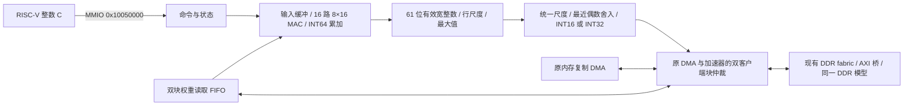
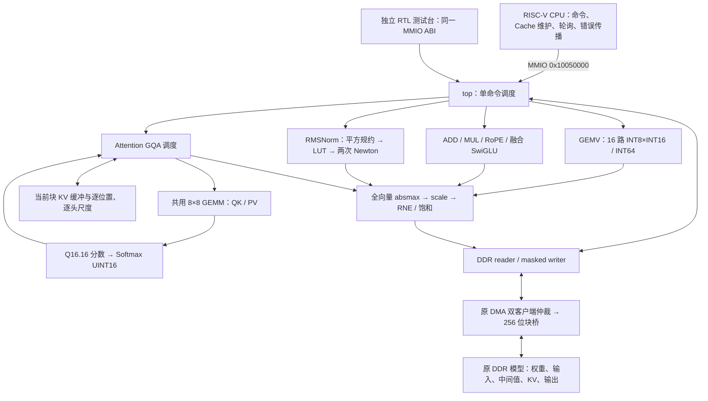

# SoC 系统学习

> 写作约束：[skills/regulation.md](../../../skills/regulation.md)。当前基线为 `baseline-rv32-soc-20261025`；三组平台仿真和标准综合完成，当前版本布局布线及上板待做。

## 1. 当前结构

当前采用 E0u `9a7edd1` 的 Core 和 `7449fe7` 的统一测量入口，固定 RAS0、OOO0、
ROB32、int8/mem4、forward3、Tournament1。核级测试包含真实 TCM；片上组裁掉
Cache RAM 和 DDR；完整组保留 Cache/DDR，按 TCM、DDR cold/warm、背景负载
分别测量。主表和证据位置见[项目介绍](../PROJECT_INTRO.md)。

2026-10-23 的首次集成基于 `origin/main@91e33f7`。P2 保存在
`baseline/p2-before-p1-20261023@f2b33b4`，历史开发分支保留。
当时 84 个 Core/包文件与该 main 一致，在 `0501f10` 上增加可选 I-cache 64 位安装、
各域频率发现和板级独立时钟/复位候选，保留总线、TCM 路由与 D-cache 换单逻辑。

`CORE_BACKEND=scoreboard` 的整机入口为 `soc_system.sv`。`soc_top.sv` 保留
旧端口的同钟兼容包装；legacy 后端仍使用原互连。Core 为 i2、ROB32、
独立 int8/mem4、关闭有限整数乱序、转发模式 3、Tournament、LQ4/SQ4、DSP/SRT4；
ALU/Load/DSP 保持 8/10/10 级。完整参数由 `p1_core_config.sh` 固定，不能只改 ROB 数量。

```text
core 域：Core IF64/D0/D1 -> cpu_memory_adapter -> I$/D$、ITCM/DTCM
                              | I/D miss、旁路
                              + 两个 AXI 主口 -> CDC
sys 域：                  axi_system_fabric <--- DMA 单 AXI 主口
                           ^                  <--- 可选外部主口
                           |
         +-----------------+----------+---------------------+
         |                 |          |                     |
     Boot ROM          SPI Flash    TCM 系统口           DDR 准入门
                                      | CDC                 | CDC
core 域：               同一份 ITCM/DTCM 的第四端口       ddr 域：DDR 目标
         |
         + AXI4-Lite64 -> CDC -> periph 域：MMIO/IRQ/UART/Timer/GPIO
                                              DMA、Cache、Flash 控制
```

图中 TCM 只有两份物理存储，各 64 KiB、两个交错 bank。前三个本地端口供
IF/D0/D1，第四端口供系统访问。DMA 访问 TCM 要经过总线、CDC 和 bank 仲裁；
CPU 的 TCM 命中不绕行系统总线。Cache 命中也留在 core 域。
Core 与 TCM/Cache 进一步分域仅为未来候选。

## 2. 时序与总线契约

系统总线使用 AXI4：32 位物理地址、256 位数据、32 位 strobe，ID 为
2 位主端号加 2 位本地号。四个主端分别为 CPU I、CPU D、DMA、外部主端。
外部主端和可选 NPU SRAM 接口都属于 sys 域，接异频设备时需要独立 CDC。

- 五个通道分别缓冲，入口和目标端为深度 2 的同步 FIFO，ready 取本地容量。
- AR/AW 地址范围检查后再过一层深度 2 的寄存队列，将译码与多主端选择分开。
- 跨域为五组深度 8 的 Gray 指针 FIFO；深度 2 也有定向测试。
- 每个目标独立轮转仲裁，读写独立；同一主端每方向最多占用四个本地 ID。
- AW 保存目标与 W owner，W 严格按该序列发送；AW/W 可独立握手。
- 被反压的 valid、载荷、owner 保持，不能因另一请求到达改换当前事务。
- 支持对齐 INCR、1–4 beat、大小不超过 32 字节；不支持的 burst/权限进入错误目标。
  4 KiB 边界由主端拆分；错误读仍返回规定 beat 数，错误写排空后返回一次 B。
- 每方向的后端 owner 数量由目标决定；DDR 准入门及原生桥各方向一个活动 owner，
  不能把互连四个 ID 槽写成 DDR 能同时执行四个读请求。

入口、译码和出口各至少增加一拍；CDC 还有指针同步和接收等待。FIFO 可连续
接收 beat，但满队列释放空间会有恢复延迟。背压测试记录连续 W 接收与最长响应
等待，不能用队列深度推算实际带宽。载荷只在握手时写，复位清有效位/指针，
减少宽数据复位扇出。历史 `soc/p2-unified-bus@e3caafe` 在 P0 Core 下完成一次
标准 PDS：84.9856 MHz、CLMA 47%、LUT 41%/39%、FF 17%、DRM 9%，未达 85 MHz。
该结果不覆盖后续 P2 优化或当前 P1+P2 集成；四域独立时钟的物理实现仍待验证。

## 3. 地址与访问

| 区域 | 基址 | 当前用途 |
| --- | --- | --- |
| ROM | `0x00000000` | 只读启动跳板，跳到 ITCM |
| ITCM / DTCM | `0x01000000` / `0x01100000` | 各 64 KiB，本地与系统端共享 RAM |
| MTIME / IRQ | `0x02000000` / `0x0c000000` | 机器定时器、软件中断与外部中断控制 |
| UART0 / UART1 | `0x10000000` / `0x10001000` | 串口，lite 省略 UART1 |
| Timer / GPIO0–2 | `0x10010000` / `0x10020000` 起 | Timer1、GPIO；lite 按 presence 缩减 |
| DMA / SoC 信息 | `0x10030000` / `0x10040000` | 单命令 DMA、设备与 Cache 控制 |
| Flash 控制 | `0x10050000` | SPI 命令、地址长度、dummy、分频、状态 |
| NPU 控制 / SRAM | `0x10060000` / `0x20000000` | 控制窗尚无设备；SRAM 可选端口，默认容量 0 |
| Flash 只读窗口 | `0x30000000` | 容量参数化，非执行，不支持写/擦除 |
| DDR | `0x80000000` | 容量参数化，可缓存代码/数据 |

原 SoC discovery ABI=1 保留。新增只读寄存器：SoC+`0x40` 扩展能力，
`0x44` DDR 状态（bit1 已配置、bit0 已就绪），`0x48` Flash 容量，`0x4c` NPU 容量。
不存在的窗口报错。RV64 高物理地址不能截断成低 32 位访问。

`CLOCK_INFO_ENABLE=1` 时，discovery `+0x3c` 的 bit8 声明频率扩展存在，major 仍为 1，
低 8 位 profile 不变。新增只读字段如下，旧 `+0x04` 保留配置值，不再用于推断不同域频率：

| SoC 信息偏移 | 内容 |
| --- | --- |
| `+0x50` | 扩展版本 1、五项 presence，值 `0x0001001f` |
| `+0x54` / `+0x58` | Core / SYS Hz |
| `+0x5c` / `+0x60` | DDR 用户口 / periph Hz |
| `+0x64` | mtime Hz，当前等于 periph |

新版 BSP 先读原 discovery，bit8 为 0 时仅用原 `+0x04`，不探测未映射地址。
启用扩展的 profile 配套新版 BSP；旧严格校验 discovery 的 BSP 会拒绝新 bit8。
Timer 超时和 tick 用 timer_hz，UART 用 periph_hz，SPI 分频用 sys_hz，mcycle 换算用
core_hz。未知版本、零频率或 timer/periph 不符返回错误。共享接口在
`software/common/soc_clocks.h`，冻结 CoreMark 镜像保持原样。

## 4. 程序和 DMA 的生命周期

复位后 CPU 从 ROM 跳转到预装 ITCM。ROM 仍只有跳板，生产 Flash 镜像的头部
检查、CRC、版本和失败恢复软件尚未实现。TCM 初始化可来自仿真镜像或 FPGA
存储初始化文件；本轮没有生成、下载 bitstream。

CPU 通过 MMIO 写 DMA 的源地址、目的地址、长度并 START。外设域把命令整包
送到 sys 域，BUSY 从命令接受持续到结果返回。DMA 用一个 AXI 主口读取源、
写入目的，双 128 B 缓冲允许读下一块和写上一块重叠。B 成功后累计成功前缀；
故障停止新请求并排空已展示事务，状态/故障地址整包返回，可查询或中断。

当前支持 TCM↔TCM、TCM↔DDR、DDR↔DDR、Flash→TCM/DDR；两端对齐时用宽块，
非对齐头尾使用同一 AXI 主口的窄访问。没有 UART FIFO DMA、描述符链、多通道，
NPU SRAM 尚未加入 DMA 地址白名单。CPU 负责命令和所有权交接，DMA 负责搬数据。

SPI 读取支持配置命令、3/4 字节地址、dummy 位与时钟分频；配置跨域原子提交，
只在空闲时应用。当前宽 Flash beat 会分成多次 XLEN 读取，每次重发 SPI 头部，
因此 Flash 持续读取带宽仍有优化空间。

## 5. Cache、MMIO 与中断

I$/D$ 仅缓存 DDR；TCM、ROM、Flash、MMIO 旁路。程序主体存放 DDR，Cache 根据
CPU 访问自动填行，软件无需先把程序搬入 Cache。每个 D$ bank 仍阻塞式处理 miss，
没有 MSHR、early restart 或硬件一致性。

P2 已保存的 DCache 优化允许同 bank 消费旧 cached 响应时接纳下一个 cached
请求，命中接纳间隔为两拍；旧 uncached 响应沿原端口协议交接。cached→uncached
仍保留边界，Store 应用、维护 pending、错误归属和反压载荷保持规则不变。
不同 bank 可并行，同 bank 双客户端按 owner 和轮转规则分配。

I-cache 新增显式候选 `SOC_ICACHE_FILL_BYTES=8`，默认仍为 4。32 B 行的块安装
由八次 32 位写变为四次 64 位写，安装尾部从九拍缩为五拍；标量填行仍发 32 位请求，
两次成功返回后合并写 RAM。填行失败后的两字回退只形成 IF64 响应，不安装缓存行。
整块检查、错误排空、失效优先和 IF64 命中每拍受理保持。
该候选不修改 D-cache 默认安装宽度，双宽 scalar/block 与兼容回归共 65 次运行通过。

DMA 读取 CPU 修改过的 DDR 数据前须 clean/flush；DMA 写回后 CPU 读取前须
invalidate。Cache 维护命令跨域整包发送，完成和最终错误状态同包返回。
FENCE.I、脏行写回失败和取指阻止行为保持原契约。常规 MMIO 为 32 位访问；
AXI4-Lite64 保留 RV64 MTIME/MTIMECMP 的单次 64 位读写，不拆成两个副作用操作。

MMIO/IRQ 状态属于 periph 域。中断状态保持到软件处理，经双触发同步和原 IRQ
寄存后送 Core，不直接跨域传单拍脉冲。协调复位同时清所有域的 FIFO 所有权，
各域同步释放；不支持仅复位一侧继续使用另一侧旧事务。

DDR 未就绪时，sys 域准入门直接返回错误，DDR 时钟停止也不阻塞这个错误路径。
已接受正常事务后若 DDR 失去时钟/校准，恢复需要协调复位；没有逐事务超时器。
板级候选 C1/C4 的 `pango_soc_reset` 使用 125 MHz 参考钟监测 DDR 健康状态和心跳，
故障时复位全部域、FIFO 两端及 DDR IP，丢弃在途事务后从 ROM 重启。
首次启动仅等待独立 SoC PLL，允许 DDR 尚未运行时执行 ROM/TCM/MMIO。
健康状态三拍同步后检测，静默停钟由 128 参考拍看门狗检测；公共复位保持 64 参考拍，
每个目标域再用三拍同步释放。该恢复不保证保存在途 DDR 写入。

## 6. 验证入口与结果

```bash
source scripts/verilator/p1_core_config.sh
make soc-axi-test XLEN=32
make soc-axi-test XLEN=64
make soc-system-test XLEN=32
make soc-system-test XLEN=64
```

`RISCV_TOOL_ROOT` 指向工具链目录。专项 runner 读取共享 `p2_core_config.sh`；
未选择配置时保留原 P0 对照，以上命令先载入完整 P1 profile，构建目录包含 Core
配置标签，不能将原 ROB16 二进制当作 P1。默认系统程序
跑 C0–C4：100/100/100/100、100/80/125/25、125/100/80/40、约85/117/93/37、
100/100/125/25 MHz；最后一组 core/sys 同频不同相。精确半周期保存在运行日志。
这些是仿真激励频率，没有对应的新 FPGA Fmax。

本轮 P1+P2 已通过双宽各 9 项 AXI/CDC/原生 DDR 定向、各 3 种子 TCM 等价检查，
及双宽 scalar/block 共 4 个严格 DCache turnover 目标，共 28 PASS、0 SKIP。
每次 DCache 测试会执行两种模式，模式选择只限定严格换单断言目标，原始 8 条
case PASS 含重复配置。24 条编译命令均核对完整 P1 宏，22 个二进制有 SHA，
测试前后源码 SHA 一致；证据在 `logs/p2/p1-adapt-20261023/focused/summary.json`。

以下为 P0 Core 下的历史 P2 功能结果：双宽各 9 项 AXI/CDC/原生 DDR 定向、
各 5 项整机异频程序通过；SoC ISA 为
RV32 59 PASS/1 SKIP、RV64 79 PASS/1 SKIP。程序实际通过 SPI 引脚模型读取代码，
DMA 装入 DDR 后执行，覆盖非对齐搬运、Cache 维护和 RV64 定时器宽访问。
DDR 模型采用确定性拍数等待，不能据此宣称真实 DDR 带宽。
原始结果在 `logs/p2/unified-bus/final/`，源码、镜像、二进制和命令有 manifest。

M2-direct 预装路径用 `SOC_DDR=1` 生成 DDR 链接镜像：入口留在 ITCM，代码放
DDR `0x80000000`，数据/栈留 DTCM；测试台用 `+DDR=<ddr.hex>` 预装模型。
RV32/RV64 C0–C4 各 5/5 PASS，日志在 `logs/p2/m2-direct-20261022/`。这是功能
验证，不代表 M2 CoreMark 性能、Flash loader 或板级启动已完成。

Pango wrapper 的 `BOARD_CLOCK_PROFILE=0` 保留四域共用 DDR 125 MHz 用户钟及等待
校准的行为；候选 C1/C4 使用独立 GPLL 输出 Core100、SYS80/100、periph25 MHz，
DDR 用户口仍为 125 MHz。未改动的厂商 GPLL 模型测得预期周期；双宽实际 CPU 的
DDR 停钟启动及 ROM→TCM→MMIO 执行通过。DDR 不可用报错及在途失锁由外部 AXI
测试端发起，协调复位后 CPU 重新从 ROM 执行，新 epoch 请求正常完成。
PLL 站点、DDR IP 共存、
生成时钟和 CDC 物理约束、IO/复位时序留给后续标准 PDS；Flash 引脚仍未接。
2026-10-23 的 schema 9 已能暂存 C1/C4，并从 `g_domain_clocks.u_soc_pll.u_pll/CLKOUT0..2`
生成 `clk_core`/`clk_sys`/`clk_periph`；profile 0 仍为 schema 8。C1 暂存
`soc-rv32-c1c` 的 557 条约束检查为 0 error，综合 PASS：76,298 LUT/159,800、
61,092 寄存器/319,600、36 DRM、4 APM、0 latch；估计 `clk_core` 36.5150 MHz
（WNS −17.386）、`clk_sys` 84.1326、`clk_periph` 73.0514、`ddrphy_sysclk` 144.7178。
没有加载 clock group、false path、max_delay 或 I/O delay；ddr→sys 和 sys→ddr
仍有跨域 setup/hold 失败，不能当作闭合。Core 的 36.5 MHz 综合估计来自 `ras.sv` 的
34 级串行恢复链，旧 r15/P2 的 85 MHz 不覆盖当前 P1 Core；place/route、bitstream
和烧板仍未完成。

B20 双宽整机 C0–C4 和时钟软件共 20 次运行通过，另有四次独立启动/恢复运行。
新版 BSP 在旧硬件上回退单频，新硬件上按各域频率配置 Timer/UART/SPI。RT-Thread
双宽 smoke 与 CoreMark 应用共四个镜像编译通过；完整 RT 运行因原有测试台引用旧
`soc_top` 层级而未完成，不能用这些编译结果代替 RT 运行验收。
证据根为 `logs/p2/joint-step3-20261023/`，性能结果见[项目介绍](../PROJECT_INTRO.md)。
当前没有新增标准 PDS、板级测试或实际十秒 CoreMark；GCC 11.4 与 GCC 16.1 镜像分开比较。

## MiniMind W8A16 可选矩阵加速器

> 合并兼容说明：默认 `soc_top`（scoreboard）继续使用上述四域 AXI4 `soc_system`。MiniMind 单时钟块总线路径另命名为 `mm3_soc_compat`，由专用 harness 实例化；旧 `0x10050000` 只属于该兼容系统。新四域系统该地址是 Flash，`0x10060000` 仅预留 NPU。两个地址映射不能混用；原生 AXI4 加速器适配尚未实现。主线/兼容两套 RV32/RV64 静态检查通过，合并后的功能回归未运行；旧 PASS 不覆盖新的公共 Core/Cache 源码。


该端点在独立 `mm3_soc_compat` 中由 `MM3_ACCEL_ENABLE` 控制，默认关闭。现有 benchmark wrapper 可通过 `SOC_MM3_ACCEL_ENABLE=1` 启用；专用 MiniMind harness 默认启用。功能关闭时原 DMA 保持直接接线；原设备编号、地址和 IRQ 不变。新增目标 `TARGET_MM3=15`，设备发现位图扩为 16 位，bit15 表示实际存在。



权重行顺序及 `IScale` 与 C 完全相同。每行先计算 `if_mul(if_mul(if_make(acc,0), input_scale), row_scale)`，保存宽整数结果；所有行完成后才决定输出尺度。中间缓冲为 6400×96 位 dyadic 数据，权重读取 FIFO 为两个 128 字节块，输入缓冲最多 2432 个 INT16。乘法用四个 32×32 部分积，除法逐位迭代，不使用浮点或 DPI 推理。

### MMIO 与内存约束

所有寄存器为 32 位自然对齐访问；RV64 使用现有 word lane 适配。窗口基址 `0x10050000`：

| 偏移 | 功能 |
|---|---|
| `0x00/0x04` | 版本 `0x4d330001`；能力：路数 bits31:25、最大行数 bits24:12、最大列数 bits11:0 |
| `0x08` | 写 1 启动；BUSY 时拒绝 |
| `0x0c` | bit0 BUSY、bit1 DONE、bit2 ERROR；完成后 W1C 清除 bit1/2 |
| `0x10` | 错误码：1 配置/地址/重叠，2 行尺度，3 DDR 读，4 DDR 写 |
| `0x14/0x18` | 行数 `1..6400`、列数 `1..2432` |
| `0x1c/0x20/0x24` | 输入 INT16、权重 INT8、逐行 IScale 的 DDR 地址 |
| `0x28/0x2c` | 输出向量、输出 IScale 的 DDR 地址 |
| `0x30/0x34` | 输入尺度 multiplier、signed exponent |
| `0x38` | 输出类型：0 为 INT16，1 为 INT32 |
| `0x40..0x78` | 八个 64 位计数：总计、装载、MAC、尺度、输出量化、写回、读等待、写等待；低字在前 |
| `0x80/0x88` | 64 位饱和与下溢归零计数 |

五个 DDR 区域要求 64 字节对齐、合法且互不重叠。输入及行尺度 multiplier 满足 `2^30 ≤ m < 2^31`，exponent 在 `[-256,256]`；全零输出采用 `m=2^30,e=1`。读取以完整 32 字节 beat 搬运，首尾仅消费有效元素，内存分配须保留 beat 对齐填充；访问不得超过 DDR 边界。写入使用有效字节掩码保护相邻数据。每块最多四个 beat，在 4 KiB 边界切分。

驱动将输入发布到 DMA，并保留旧输出的干净 Cache 副本用于检验失效路径；命令期间 CPU 不访问 DMA 拥有的输入/输出区域。完成后 FLUSH 保存 CPU 其他脏行并失效旧输出，再读取结果。DONE 只在输出及尺度的写响应结束后置位。失败输出可能不完整，运行时立即向上传播错误；超时后不能继续提交命令，应复位协调后的系统。

### 仿真布局与验收边界

MiniMind 专用裸机 ELF 复用 BSP 启动、TCM 和 tohost：代码位于 64 KiB ITCM，栈及 tohost 位于 DTCM，大对象和只读字符串位于 DDR。DDR 默认模拟 128 MiB：程序数据起于 `0x80000000`，启动配置/结果在 `0x80400000/0x80401000`，诊断 trace 起于 `0x80410000`，模型在 `0x81000000`，分词器在 `0x85000000`，对齐堆起于 `0x86000000`。两个后端预留相同缓冲区，不能因选择硬件而移动 KV 或输入地址。

新分支仅完成/验证 Verilator 路径；尚无该加速器的 PDS 面积、时序或板上运行证据。可综合结构不等于已通过 FPGA 资源与时序验收。

已执行的阶段结果和长任务状态集中记录在 `software/minimind3/README.md`，原始证据保存在忽略的 `logs/mm3/` 和 `build/mm3/`。周期比必须对应同一宽度、CPU 配置、ELF 和 DDR 模型；旧版或中途替换任务的结果保留但不作为正式验收。

### 验收暂停状态（2026-10-26）

当前分支已实现上述数据通路和软件连接；暂停后已按用户要求恢复验收。RV32/RV64 数学/GEMV 单元、SoC 小矩阵与并发 DMA 已有通过证据；7 个真实 Linear 完成逐值对照。真实 Head 配对、单层和完整八层生成尚未完成，不能视为整机验收通过。详细周期、误差、已知 P1 directed 监视器失败、日志位置和恢复顺序统一记录在 [MiniMind 交接说明](../../software/minimind3/README.md#暂停时的设计与验收交接2026-10-26)。恢复后的严格测试台等待结果 Store 的成功响应及正常退休，详细状态见同一交接说明。

## 整数算子扩展（2026-10-27）

本节描述 `codex/mm3-integer-operators` 新增实现，**后续用户运行的RV32单算子、T=4 Attention和单Token第0层独立链/CPU链已通过比较，综合/上板未验收**。旧版 GEMV 的已执行结果见前节；不能作为本节算子链的数值证据。使用命令、配置表和待验收记录集中在 [MiniMind 使用说明](../../software/minimind3/README.md#整数算子扩展交付2026-10-27)。

### 目录、计算与调度

```text
vsrc/soc/mm3/
  mm3_config.h       中文配置源，生成 SV 包及 C/RTL 常量表
  common/            fixed_t、四肢乘法/迭代除法、重定标、DMA reader、向量调度
  gemv/              原 16 路 INT8×INT16 Linear
  gemm/              可配置 8×8 脉动阵列与寄存器化 PE
  ew_add/ ew_mul/    尺度对齐相加、宽整数乘积
  rmsnorm/           平衡平方规约、LUT＋Newton、γ 与输出系数
  rope/ softmax/    整数旋转、指数表与最大余数概率
  swiglu/            sigmoid 表与整数插值，融合宽乘
  kv_cache/          KV 位置、DDR 地址与有效握手控制
  attention/         GQA 的 QK → Softmax → PV 调度
  top/               GEMV 兼容封装、描述符解析、缓冲装载/写回
software/minimind3/operators/
  mm3_ops.h/.c       版本化命令与整数 C 参考，包括新 RMSNorm
  mm3_tables.h       自动生成的 C 常量
  mm3_driver.c       Cache 所有权交接、MMIO、错误和超时传播
  mm3_layer_main.c   真 CPU 单层命令驱动
  mm3_reference_main.c  仅显式测试时运行的宿主 C 参考入口
```



CPU-free 链由 BFM 编程 MMIO；真实 CPU 入口由裸机 C 编程相同寄存器。二者都从 DDR 读取上一个算子的实际写回结果。宿主 Python/C 结果不连接到计算通路。没有引入新 DDR 端口或 DPI 数学替代。

### 数值格式与重定标

`IScale={uint32 m,int32 e}`，小端 8 字节，真实值为 `整数 × m × 2^(e−31)`。正常尺度满足 `2^30≤m<2^31`；旧接口约束 e 在 −256..256，新描述符加载也检查该范围。内部 `fixed_t/IFixed={signed64 v,signed32 e}` 保持归一化的 61 位有效整数，真实值为 `v×2^e`。C 使用显式多字整数，RTL 使用整数寄存器与部分积，不依赖浮点、DW 或 C `__int128`。

“重定标”是把宽整数和旧尺度代表的真实值转换到新的统一尺度。先扫描整个输出向量的绝对值最大值；用 `max/32767` 向上选择可表示 `IScale`，再逐元素除以该尺度、最近偶数舍入、对称饱和到 INT16 的 −32767..32767。全零向量固定 `m=2^30,e=1`。不能逐行各选尺度后把整数直接混用。头部 INT32 logits 仍由旧 GEMV 路径处理；本次单层不调用 Head。

| 算子 | 输入和中间运算 | 输出边界 |
|---|---|---|
| GEMV | 原 INT8 行权重×INT16；INT64 内积；按原 `acc→input scale→row scale` 顺序舍入 | 全向量 INT16＋scale，或旧 Head INT32＋scale |
| GEMM QK | signed INT16×INT16，8×8 分块 PE，逐拍传递并累加 | 原始 INT64 矩阵；尺度由 Attention 后处理 |
| GEMM PV | 概率解释成 unsigned INT16；V 已对齐为 signed INT32 | INT64 矩阵；不把概率当 signed16 |
| ADD | 两路分别转为 dyadic 值，对齐指数、宽整数加法 | 全向量重定标 INT16 |
| MUL | INT16×INT16 宽积，结合两路尺度 | 全向量重定标 INT16 |
| RoPE | 第 i 项与 i+48 项配对；Q1.15 表的 cos/sin 宽乘加 | factor 的指数减 15，再重定标 INT16 |
| Softmax | INT32 Q16.16 减最大值；原 exp 表4097项，−16..0、步长1/256，整数插值 | UINT16/65535；最大余数法使总和为65535，同余数先小位置 |
| SwiGLU | 原 sigmoid 表8193项、−16..16、步长1/256、UINT16/65535；Gate×Up×sig 宽整数融合 | 结合两路尺度并除65535后，一次压为 INT16 |
| KV | DDR 中 signed INT16 K/V，尺度按位置/4个KV头分别存储 | 原样读写；支持当前 V 向量单尺度广播4头 |

Softmax 更小的分数贡献置零；SiLU 的 sigmoid 区间外取 0/65535。保留原表与整数插值定义。本次扩展 MMIO 的 `0x80/0x88` 只报告最终 pack 的饱和/下溢，Softmax/GEMM/KV 为零；C 参考另外打印 exp/sigmoid 范围外计数。没有把这些有限统计宣称为覆盖所有内部数值异常的完整审计。

### RMSNorm 的明确舍入路径

设输入为 `x_i = a_i × sx`，γ 为 `g_i × sg`。平方和用 INT64；分组平方、平衡树每级寄存，尾部填零，再累计各组。长度倒数为离线 `RNE(2^48/n)` 整数常量，用乘法与指数 −48 参与均值计算，保留原模型 ε。

```text
sx² → sum(a²)×sx² → × reciprocal(n) → +ε = s
s = normalized_v × 2^e，normalized_v 含61位有效数字
E=e+60；p=E mod 2（结果0或1）；k=(E-p)/2
 t = RNE(normalized_v >> (30-p))，解释为 Q2.30 的 m×2^p
 index = 尾数高8位 + p×256
 y = LUT[index]，解释为 unsigned Q1.31
重复两次：
 y2 = RNE(y*y >> 31)
 ty2 = RNE(t*y2 >> 30)
 correction = RNE(((3<<31)-ty2) >> 1)
 y = min(1<<31, RNE(y*correction >> 31))
 invsqrt = make_fixed(y, -31-k)
 factor = sx×sg×invsqrt
 out_i = pack(make_fixed(a_i*g_i) × factor)
```

LUT 在每个尾数区间中点生成 `1/sqrt(t)` 初值，512 项由 Decimal 离线计算；运行计算没有平方根或通用除法器出现在倒平方根系数路径。负指数按二进制奇偶位拆分，等效于数学上的非负余数，不能用 C 负数除法直接猜奇偶。t 的存储保留舍入到 4.0 时的额外位；乘积使用 UINT64，RNE/修正分开寄存。查表、平方、乘 t、修正、乘 y、恢复指数是实际阶段，不以等待计数冒充流水线。

外层公共 pack 仍使用原多周期整数除法，和“倒平方根系数不使用除法”分开。LUT＋Newton 是新近似算法，不承诺逐位等于旧整数 sqrt；同输入旧版差异在用户运行 `mm3-ref` 后写入 `fixture.json`。本轮没有计算该误差。

### Attention、GEMM 与 KV 布局

Q 有 8 头，K/V 有 4 头，头维度 96；查询头 h 使用 KV 头 `h/2`。当前实现逐查询头调度同一 GEMM 阵列：

1. QK：A 为 1×96，B 以 T×96 存储并转置读取，输出 T 个 INT64；每位置依次乘 `query_scale × invsqrt96` 和对应 `key_scale[t,kh]`，转 Q16.16。
2. Softmax：保留最大余数法输出规则。
3. PV：在非零 V 位置选最大的头尺度，指数减14作为对齐基准；每个位置的 V 按自身尺度对齐并转 INT32，不能直接累加不同尺度的 INT16。A 为 UINT16 概率1×T，B 为 INT32 T×96，由同一阵列算 INT64；乘 `base_scale/65535` 后生成宽输出。
4. 8 头的 768 个输出一起选择 scale、重定标。全零 V 沿用固定基准后处理。

默认单 Token T=1 不足以证明历史 Attention 正确，因此另提供 T=4、非恒定概率、不同 K/V 尺度的小用例。单 Token 的 GEMM 利用率低，8×8 PE 数量不等于达到64倍吞吐；性能尚待实测。

单层 KV 位置 t 的数据地址为 `keys/values + t×384×2`，尺度为 `ks/vs + t×4×8`。完整模型的层基址由软件另行选择；本次夹具只提供第0层。DDR 保留全部 KV，算子引擎只缓冲当前命令需要的 T 个位置；KV 模块负责地址/容量/握手，不假装拥有整模型片上缓存。

GEMM 输入步长以元素为单位，0 表示紧密排列；A 至少 k，B 转置时至少 k，否则至少 n。跨度不得超过配置缓冲容量。PE 的 A 为17位（兼容 signed16 与 unsigned16），B 为32位；乘积49位、INT64累加。每块清零、按行列偏斜注入、排空流水后回收有效尾部；输出固定连续行主序。外部 valid 等待 ready 时载荷保持，内部 PE 使用统一 advance。

### MMIO 扩展与描述符

旧 `0x00..0x8c` 的 GEMV 编程接口保留；设备号和窗口不变。新寄存器：

| 偏移 | 含义 |
|---|---|
| `0x90` | opcode：0 为旧 GEMV；1 ADD、2 MUL、3 RMSNorm、4 RoPE、5 Softmax、6 SwiGLU、7 GEMM、8 KV、9 Attention |
| `0x94` | 64字节对齐的128字节 DDR 描述符地址 |
| `0x98` | 只读 ABI 版本 `0x00010000` |
| `0x9c` | 扩展能力位 `0x000003fe`（bit1..9） |

扩展命令仍写 `0x08=1` 启动，轮询 `0x0c`，读取 `0x10` 错误码。错误码1为描述符/容量/地址，2为尺度或计算错误，3读DDR，4写DDR；ERROR 与 DONE 互斥。BUSY 时拒绝再启动或修改配置。DONE/ERROR 保持到 W1C；清状态同时将 opcode 归零，方便下一条旧 GEMV 命令。不成功时驱动返回错误，不静默调用软件。

`MM3Command` 小端32个uint32，C静态断言128字节；两份后端使用同一结构：

| word / 字节偏移 | 字段 | 说明 |
|---|---|---|
| 0 / 0 | magic | `0x334f5031` |
| 1..5 / 4..20 | op,n,m,k,flags | n为向量长度/GEMM列/GEMV行，m为GEMM行，k为内积长度 |
| 6..8 / 24..32 | a,b,out | DDR 输入/输出地址 |
| 9..11 / 36..44 | as,bs,os | 输入/输出 IScale 地址；GEMV bs为逐行尺度 |
| 12..13 / 48..52 | aux,aux_scale | aux为表地址，aux_scale本版保留零 |
| 14..15 / 56..60 | pos,length | KV位置、Attention有效长度 |
| 16..17 / 64..68 | eps_m,eps_e | Norm ε 的整数尺度 |
| 18..22 / 72..88 | keys,values,ks,vs,capacity | KV 基址和容量 |
| 23..24 / 92..96 | inv_m,inv_e | Attention `1/sqrt(96)` 离线常量 |
| 25..26 / 100..104 | stride_a,stride_b | GEMM 输入元素步长，0为连续 |
| 27..31 / 108..124 | reserved | 保留零 |

GEMM flags bit0 选择 UINT16×INT32，bit1 选择转置 B。KV flags bit0 读取当前槽，否则写入；bit1 在写入时将单个 V scale 广播4头。其他字段按算子解释，未用字段写零。Softmax 输入为 INT32、输出 UINT16，无输出尺度；GEMM 原始输出 INT64，无输出尺度；其他计算向量输出 INT16＋单个 IScale；Attention as 指向8个查询头尺度，KV as/bs通常各4个尺度。

新引擎先读完全部输入再计算/写回，支持 RoPE 原地更新；各独立输入/输出分配需留到32字节 beat边界的可读填充。正常夹具按64字节分配；每个头的8字节尺度可位于同一分配块内。新输出允许自然元素对齐并用 strobe 保护相邻字节，不沿用旧 GEMV 的五区全64字节对齐限制。**旧 GEMV 仍要求原来的64字节对齐且不重叠。** 多个输出区不能互相覆盖，软件负责分配；新引擎尚未提供所有可能别名组合的冲突检测。命令中途失败时结果可能不完整，超时/DDR故障后应协调复位，不继续推理。

DMA 使用原 reader 拆成最多128字节块并在4KiB处分段。扩展 writer 每次一个32字节masked beat，等待写响应后继续，最后一个尺度/数据写响应结束才能报告成功。旧 GEMV 和扩展引擎互斥，共用原加速器在 SoC 的块客户端；该客户端再与原 DMA 仲裁，不绕过共享 DDR 时序。

### Cache、夹具与复现边界

驱动提交前 CLEAN，命令期间 CPU 不触碰 DMA 所有的输入/输出，成功后 FLUSH 并 fence 再读结果。描述符也必须发布给 DMA。BFM 没有 Cache；CPU入口才实际覆盖维护代码。设备关闭/开启 lint 仅检查结构，不能证明脏输入发布和旧输出失效正确。

新算子夹具地址与原完整模型路径分开使用：控制 `0x80400100`，命令 `0x80410000`，比较区域表 `0x80420000`，负向用例描述符 `0x80430000`，初始 image `0x81000000`。同一DDR模型仍为128MiB。裸机代码/栈沿用ITCM/DTCM，单层权重、所有大数组、KV及中间结果在DDR；宿主预校验夹具后预装，CPU执行描述符链。

统一配置生成工具不执行模型；`mm3-static-check` 不导入 Python 数值参考。用户显式执行 `mm3-ref` 或仿真入口时才生成数值。`TRACE=1` 保存 C/Python/RTL 的每命令输出与尺度，回归报告按原始整数逐字节比较；数值不一致会非零退出。静态报告、源码/ELF SHA、工具版本、当前实际检查及待填写的误差/周期表见使用说明。功能、复位/DDR故障、缓存并发、综合资源、时序和FPGA运行仍需后续验收；当前结论不超出静态编译/lint。
