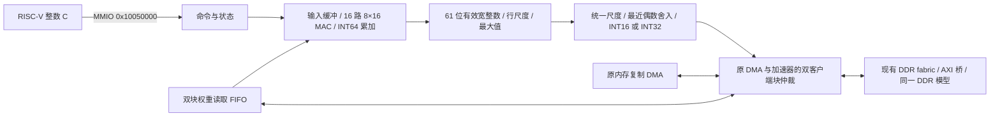
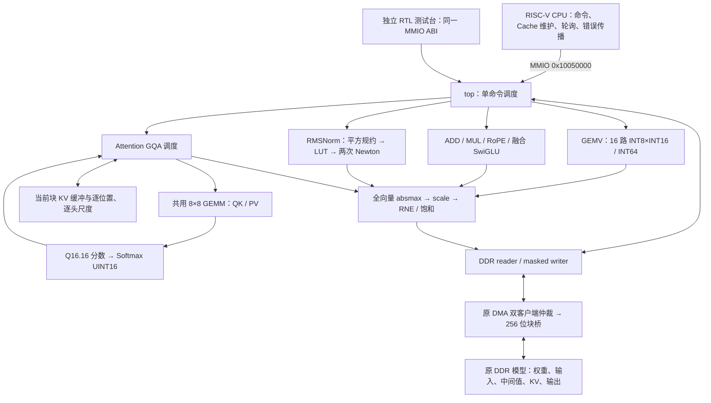

# SoC 系统学习

> 写作约束：[skills/regulation.md](../../../skills/regulation.md)。本文是当前实现的摘要，细节以源码和对应测试为准。

## 1. 从 Core 到 SoC 的层次

`CORE_BACKEND=scoreboard` 选择新双发射 Core 与 `scoreboard_soc_memory`：
IF64、D0/D1、DMA 分别持有事务；两块 64 KiB TCM 各用两个交错 bank，
TCM 响应反压存入客户端缓冲，其他客户端仍可访问 RAM。原生 I$ 命中 II=1，
两个 D$ bank 按缓存行分区并共享外部 DDR 带宽。D$ 总容量和软件维护契约保留，
维护命令须等待两个 bank 完成。测试与当前边界见 [双发射学习](DUAL_ISSUE.md)。
`LOCAL_TCM_ENABLE` 仅选择 legacy 的两种接线；新后端固定使用上述原生 bank 路由。
`555453f` 起，D0/D1 在 SoC 地址解码前各有两项请求缓冲，ready 只依赖寄存容量，
每笔请求增加一拍，稳态各口仍可每拍接受。已接纳的取消读继续外发并排空，
标签由 LSQ 保持；Store/MMIO 的队头授权在进入缓冲之前完成。

下面的单 D 口框图与 local0/local1 时序说明保留为 legacy 控制组说明。

```text
Core I 口 ── I$ / uncached ── I router ─┐
Core D 口 ── D$ / uncached ── D router ─┼─ 热路：local TCM fabric ─ ITCM / DTCM
DMA 窄口 ──────────────────── DMA router ┘
                    各 router 的慢口
                           ↓
                  主端事务寄存槽
                           ↓
                  shared per-target fabric
                  ├─ ROM / error slave
                  ├─ 每个设备请求槽 → MMIO 响应寄存器
                  └─ DDR 请求寄存槽 → DDR 仲裁/桥
DMA 256 位块口 ─────────────────────────────┘
```

- `vsrc/core/`：可移植 Core。
- `vsrc/pkg/`：类型、地址、配置、总线包。
- `vsrc/soc/`：Cache、总线、TCM、ROM、DMA、外设。
- `vsrc/cpu/`：FPGA wrapper、Pango DDR 桥。
- `vsrc/sim_cpu/`：仿真存储模型。

三主端 I/D/DMA 可以同时访问不同目标。每个目标有 owner，同一目标同一时间只接一笔。
主端 ready 不能组合穿透到另一个主端。

## 2. 总线契约

`bus_types_pkg::bus_req_t` 包含地址、读写、大小、写数据、strobe、execute 等字段；
`bus_rsp_t` 包含读数据、错误码、响应。关键规则：

1. `valid && ready` 是接受沿；接受后的请求归下游 owner，不能靠清 valid 撤销。
2. 响应必须按接受时的 owner 返回，不能按当前地址猜。
3. 已展示的 valid 在反压时保持载荷。
4. 错误分为 BUS_OK、BUS_DECERR、BUS_SLVERR；未映射窗口返回 DECERR，权限/大小
   错误返回 SLVERR。
5. Cache 维护、FENCE.I、DMA 和普通访问对同一地址的所有权必须分开处理。

详细接口见 `vsrc/pkg/bus_types_pkg.sv`、`vsrc/soc/bus/bus_interconnect.sv`、
`vsrc/soc/common/bus_transaction_register.sv`。

## 3. 地址与存储

- ITCM：64 KiB，`soc_addr_pkg::ITCM_BASE`，同步读、byte 写。
- DTCM：64 KiB，`soc_addr_pkg::DTCM_BASE`。
- Boot ROM、错误从机、UART/Timer/GPIO/DMA/系统信息等 MMIO。
- DDR：`soc_addr_pkg::DDR_BASE`，容量由 `DDR_BYTES` 参数决定。
- `address_decode` 并行产生互斥窗口命中，保留完整范围、对齐、写权限、MMIO
  word-only 和未映射错误优先级。

`LOCAL_TCM_ENABLE=1` 时，合法 TCM 请求走 hot 路，不经过慢 fabric；`0` 时 TCM
也在慢 fabric 后。两种接线共用同一份物理 TCM RAM。热路仍有本主端 owner 和响应 FF，
不是 1 拍专用口。

## 4. Cache

- I$：2 路、4 KiB、32 B 行，只缓存合法 DDR 取指；TCM/ROM/MMIO 旁路。
- D$：2 路、4 KiB、32 B 行，WB/WA；只覆盖 DDR，MMIO/TCM 旁路。
- 命中路径是 IDLE→LOOKUP→RESPOND；load 命中 II=3，store 命中多一拍。
- miss 先探测 victim，脏行完整写回后才填行；填行成功才安装。
- 填行/写回可走 256 位块口（`CACHE_BLOCK_ENABLE=1`），但 RAM 仍逐 word 写。
- FENCE.I：I$ 失效、D$ clean、旧取指响应排空；维护失败停取指。
- DMA 与 CPU 的数据所有权靠软件 clean/flush/invalidate，不靠硬件一致性。

## 5. 外设与中断

- UART0/1：TX busy 时写返回 SLVERR，RX 只有一字节缓冲，满时 overrun。
- Timer0：mtime/mtimecmp 和机器软件中断；Timer1：通用计数器。
- GPIO0/1/2：32 位输入/输出/输出使能。
- DMA：legacy 单描述符逐字搬运；block engine 用两槽 128 B 和 256 位口。
- IRQ：`irq_controller` 的 pending/in-service/enable/threshold；`irq_register`
  把设备中断同步一拍后送 Core。
- MMIO 端点：请求先寄存，SEND 才执行副作用，WAIT_RESPONSE 消费后回 IDLE。

## 6. 软件测试栈

- `benchmark/`：CoreMark port、裸机 runtime、链接脚本。
- `tb/`：unit、directed、riscv-tests adapter、SoC benchmark。
- `scripts/verilator/`：runner、模型构建、镜像生成。
- RT-Thread v5.2.2：UART loader、TCM/DDR 布局、DMA 热代码搬运。
- 判定：tohost/console 或 Store 成功响应 + 同 ID 正常退休；不能看到请求就宣告 PASS。

## 7. 修改时先查什么

1. 地址常量、目标编码、互连 `PRESENT`、`soc_top`/`soc_peripherals` 连线。
2. 一笔请求的 `req_fire`、`rsp_fire`、旧响应 owner、错误地址、复位处置。
3. Cache 与 DMA 的 clean/flush/invalidate 顺序。
4. FENCE.I 在 miss、写回、维护中的到达时机。
5. RV32 和 RV64 都跑；共享 RTL 不能只测一个宽度。

## 8. 当前边界

- 没有硬件 Cache 一致性；DMA 需要软件维护。
- 没有 MSHR、hit-under-miss、store buffer、early restart。
- 没有异步 CDC；SoC 和 DDR 用户口仍同为 125 MHz 域。
- 没有真实 DDR 颗粒、板上 UART/ILA 或功耗测量。

## MiniMind W8A16 可选矩阵加速器

该端点在 `soc_top` 中由 `MM3_ACCEL_ENABLE` 控制，默认关闭。现有 benchmark wrapper 可通过 `SOC_MM3_ACCEL_ENABLE=1` 启用；专用 MiniMind harness 默认启用。功能关闭时原 DMA 保持直接接线；原设备编号、地址和 IRQ 不变。新增目标 `TARGET_MM3=15`，设备发现位图扩为 16 位，bit15 表示实际存在。



权重行顺序及 `IScale` 与 C 完全相同。每行先计算 `if_mul(if_mul(if_make(acc,0), input_scale), row_scale)`，保存宽整数结果；所有行完成后才决定输出尺度。中间缓冲为 6400×96 位 dyadic 数据，权重读取 FIFO 为两个 128 字节块，输入缓冲最多 2432 个 INT16。乘法用四个 32×32 部分积，除法逐位迭代，不使用浮点或 DPI 推理。

### MMIO 与内存约束

所有寄存器为 32 位自然对齐访问；RV64 使用现有 word lane 适配。窗口基址 `0x10050000`：

| 偏移 | 功能 |
|---|---|
| `0x00/0x04` | 版本 `0x4d330001`；能力：路数 bits31:25、最大行数 bits24:12、最大列数 bits11:0 |
| `0x08` | 写 1 启动；BUSY 时拒绝 |
| `0x0c` | bit0 BUSY、bit1 DONE、bit2 ERROR；完成后 W1C 清除 bit1/2 |
| `0x10` | 错误码：1 配置/地址/重叠，2 行尺度，3 DDR 读，4 DDR 写 |
| `0x14/0x18` | 行数 `1..6400`、列数 `1..2432` |
| `0x1c/0x20/0x24` | 输入 INT16、权重 INT8、逐行 IScale 的 DDR 地址 |
| `0x28/0x2c` | 输出向量、输出 IScale 的 DDR 地址 |
| `0x30/0x34` | 输入尺度 multiplier、signed exponent |
| `0x38` | 输出类型：0 为 INT16，1 为 INT32 |
| `0x40..0x78` | 八个 64 位计数：总计、装载、MAC、尺度、输出量化、写回、读等待、写等待；低字在前 |
| `0x80/0x88` | 64 位饱和与下溢归零计数 |

五个 DDR 区域要求 64 字节对齐、合法且互不重叠。输入及行尺度 multiplier 满足 `2^30 ≤ m < 2^31`，exponent 在 `[-256,256]`；全零输出采用 `m=2^30,e=1`。读取以完整 32 字节 beat 搬运，首尾仅消费有效元素，内存分配须保留 beat 对齐填充；访问不得超过 DDR 边界。写入使用有效字节掩码保护相邻数据。每块最多四个 beat，在 4 KiB 边界切分。

驱动将输入发布到 DMA，并保留旧输出的干净 Cache 副本用于检验失效路径；命令期间 CPU 不访问 DMA 拥有的输入/输出区域。完成后 FLUSH 保存 CPU 其他脏行并失效旧输出，再读取结果。DONE 只在输出及尺度的写响应结束后置位。失败输出可能不完整，运行时立即向上传播错误；超时后不能继续提交命令，应复位协调后的系统。

### 仿真布局与验收边界

MiniMind 专用裸机 ELF 复用 BSP 启动、TCM 和 tohost：代码位于 64 KiB ITCM，栈及 tohost 位于 DTCM，大对象和只读字符串位于 DDR。DDR 默认模拟 128 MiB：程序数据起于 `0x80000000`，启动配置/结果在 `0x80400000/0x80401000`，诊断 trace 起于 `0x80410000`，模型在 `0x81000000`，分词器在 `0x85000000`，对齐堆起于 `0x86000000`。两个后端预留相同缓冲区，不能因选择硬件而移动 KV 或输入地址。

新分支仅完成/验证 Verilator 路径；尚无该加速器的 PDS 面积、时序或板上运行证据。可综合结构不等于已通过 FPGA 资源与时序验收。

已执行的阶段结果和长任务状态集中记录在 `software/minimind3/README.md`，原始证据保存在忽略的 `logs/mm3/` 和 `build/mm3/`。周期比必须对应同一宽度、CPU 配置、ELF 和 DDR 模型；旧版或中途替换任务的结果保留但不作为正式验收。

### 验收暂停状态（2026-10-26）

当前分支已实现上述数据通路和软件连接；暂停后已按用户要求恢复验收。RV32/RV64 数学/GEMV 单元、SoC 小矩阵与并发 DMA 已有通过证据；7 个真实 Linear 完成逐值对照。真实 Head 配对、单层和完整八层生成尚未完成，不能视为整机验收通过。详细周期、误差、已知 P1 directed 监视器失败、日志位置和恢复顺序统一记录在 [MiniMind 交接说明](../../software/minimind3/README.md#暂停时的设计与验收交接2026-10-26)。恢复后的严格测试台等待结果 Store 的成功响应及正常退休，详细状态见同一交接说明。

## 整数算子扩展（2026-10-27）

本节描述 `codex/mm3-integer-operators` 新增实现，**仅完成静态检查，功能仿真待用户运行**。旧版 GEMV 的已执行结果见前节；不能作为本节算子链的数值证据。使用命令、配置表和待验收记录集中在 [MiniMind 使用说明](../../software/minimind3/README.md#整数算子扩展交付2026-10-27)。

### 目录、计算与调度

```text
vsrc/soc/mm3/
  mm3_config.h       中文配置源，生成 SV 包及 C/RTL 常量表
  common/            fixed_t、四肢乘法/迭代除法、重定标、DMA reader、向量调度
  gemv/              原 16 路 INT8×INT16 Linear
  gemm/              可配置 8×8 脉动阵列与寄存器化 PE
  ew_add/ ew_mul/    尺度对齐相加、宽整数乘积
  rmsnorm/           平衡平方规约、LUT＋Newton、γ 与输出系数
  rope/ softmax/    整数旋转、指数表与最大余数概率
  swiglu/            sigmoid 表与整数插值，融合宽乘
  kv_cache/          KV 位置、DDR 地址与有效握手控制
  attention/         GQA 的 QK → Softmax → PV 调度
  top/               GEMV 兼容封装、描述符解析、缓冲装载/写回
software/minimind3/operators/
  mm3_ops.h/.c       版本化命令与整数 C 参考，包括新 RMSNorm
  mm3_tables.h       自动生成的 C 常量
  mm3_driver.c       Cache 所有权交接、MMIO、错误和超时传播
  mm3_layer_main.c   真 CPU 单层命令驱动
  mm3_reference_main.c  仅显式测试时运行的宿主 C 参考入口
```



CPU-free 链由 BFM 编程 MMIO；真实 CPU 入口由裸机 C 编程相同寄存器。二者都从 DDR 读取上一个算子的实际写回结果。宿主 Python/C 结果不连接到计算通路。没有引入新 DDR 端口或 DPI 数学替代。

### 数值格式与重定标

`IScale={uint32 m,int32 e}`，小端 8 字节，真实值为 `整数 × m × 2^(e−31)`。正常尺度满足 `2^30≤m<2^31`；旧接口约束 e 在 −256..256，新描述符加载也检查该范围。内部 `fixed_t/IFixed={signed64 v,signed32 e}` 保持归一化的 61 位有效整数，真实值为 `v×2^e`。C 使用显式多字整数，RTL 使用整数寄存器与部分积，不依赖浮点、DW 或 C `__int128`。

“重定标”是把宽整数和旧尺度代表的真实值转换到新的统一尺度。先扫描整个输出向量的绝对值最大值；用 `max/32767` 向上选择可表示 `IScale`，再逐元素除以该尺度、最近偶数舍入、对称饱和到 INT16 的 −32767..32767。全零向量固定 `m=2^30,e=1`。不能逐行各选尺度后把整数直接混用。头部 INT32 logits 仍由旧 GEMV 路径处理；本次单层不调用 Head。

| 算子 | 输入和中间运算 | 输出边界 |
|---|---|---|
| GEMV | 原 INT8 行权重×INT16；INT64 内积；按原 `acc→input scale→row scale` 顺序舍入 | 全向量 INT16＋scale，或旧 Head INT32＋scale |
| GEMM QK | signed INT16×INT16，8×8 分块 PE，逐拍传递并累加 | 原始 INT64 矩阵；尺度由 Attention 后处理 |
| GEMM PV | 概率解释成 unsigned INT16；V 已对齐为 signed INT32 | INT64 矩阵；不把概率当 signed16 |
| ADD | 两路分别转为 dyadic 值，对齐指数、宽整数加法 | 全向量重定标 INT16 |
| MUL | INT16×INT16 宽积，结合两路尺度 | 全向量重定标 INT16 |
| RoPE | 第 i 项与 i+48 项配对；Q1.15 表的 cos/sin 宽乘加 | factor 的指数减 15，再重定标 INT16 |
| Softmax | INT32 Q16.16 减最大值；原 exp 表4097项，−16..0、步长1/256，整数插值 | UINT16/65535；最大余数法使总和为65535，同余数先小位置 |
| SwiGLU | 原 sigmoid 表8193项、−16..16、步长1/256、UINT16/65535；Gate×Up×sig 宽整数融合 | 结合两路尺度并除65535后，一次压为 INT16 |
| KV | DDR 中 signed INT16 K/V，尺度按位置/4个KV头分别存储 | 原样读写；支持当前 V 向量单尺度广播4头 |

Softmax 更小的分数贡献置零；SiLU 的 sigmoid 区间外取 0/65535。保留原表与整数插值定义。本次扩展 MMIO 的 `0x80/0x88` 只报告最终 pack 的饱和/下溢，Softmax/GEMM/KV 为零；C 参考另外打印 exp/sigmoid 范围外计数。没有把这些有限统计宣称为覆盖所有内部数值异常的完整审计。

### RMSNorm 的明确舍入路径

设输入为 `x_i = a_i × sx`，γ 为 `g_i × sg`。平方和用 INT64；分组平方、平衡树每级寄存，尾部填零，再累计各组。长度倒数为离线 `RNE(2^48/n)` 整数常量，用乘法与指数 −48 参与均值计算，保留原模型 ε。

```text
sx² → sum(a²)×sx² → × reciprocal(n) → +ε = s
s = normalized_v × 2^e，normalized_v 含61位有效数字
E=e+60；p=E mod 2（结果0或1）；k=(E-p)/2
 t = RNE(normalized_v >> (30-p))，解释为 Q2.30 的 m×2^p
 index = 尾数高8位 + p×256
 y = LUT[index]，解释为 unsigned Q1.31
重复两次：
 y2 = RNE(y*y >> 31)
 ty2 = RNE(t*y2 >> 30)
 correction = RNE(((3<<31)-ty2) >> 1)
 y = min(1<<31, RNE(y*correction >> 31))
 invsqrt = make_fixed(y, -31-k)
 factor = sx×sg×invsqrt
 out_i = pack(make_fixed(a_i*g_i) × factor)
```

LUT 在每个尾数区间中点生成 `1/sqrt(t)` 初值，512 项由 Decimal 离线计算；运行计算没有平方根或通用除法器出现在倒平方根系数路径。负指数按二进制奇偶位拆分，等效于数学上的非负余数，不能用 C 负数除法直接猜奇偶。t 的存储保留舍入到 4.0 时的额外位；乘积使用 UINT64，RNE/修正分开寄存。查表、平方、乘 t、修正、乘 y、恢复指数是实际阶段，不以等待计数冒充流水线。

外层公共 pack 仍使用原多周期整数除法，和“倒平方根系数不使用除法”分开。LUT＋Newton 是新近似算法，不承诺逐位等于旧整数 sqrt；同输入旧版差异在用户运行 `mm3-ref` 后写入 `fixture.json`。本轮没有计算该误差。

### Attention、GEMM 与 KV 布局

Q 有 8 头，K/V 有 4 头，头维度 96；查询头 h 使用 KV 头 `h/2`。当前实现逐查询头调度同一 GEMM 阵列：

1. QK：A 为 1×96，B 以 T×96 存储并转置读取，输出 T 个 INT64；每位置依次乘 `query_scale × invsqrt96` 和对应 `key_scale[t,kh]`，转 Q16.16。
2. Softmax：保留最大余数法输出规则。
3. PV：在非零 V 位置选最大的头尺度，指数减14作为对齐基准；每个位置的 V 按自身尺度对齐并转 INT32，不能直接累加不同尺度的 INT16。A 为 UINT16 概率1×T，B 为 INT32 T×96，由同一阵列算 INT64；乘 `base_scale/65535` 后生成宽输出。
4. 8 头的 768 个输出一起选择 scale、重定标。全零 V 沿用固定基准后处理。

默认单 Token T=1 不足以证明历史 Attention 正确，因此另提供 T=4、非恒定概率、不同 K/V 尺度的小用例。单 Token 的 GEMM 利用率低，8×8 PE 数量不等于达到64倍吞吐；性能尚待实测。

单层 KV 位置 t 的数据地址为 `keys/values + t×384×2`，尺度为 `ks/vs + t×4×8`。完整模型的层基址由软件另行选择；本次夹具只提供第0层。DDR 保留全部 KV，算子引擎只缓冲当前命令需要的 T 个位置；KV 模块负责地址/容量/握手，不假装拥有整模型片上缓存。

GEMM 输入步长以元素为单位，0 表示紧密排列；A 至少 k，B 转置时至少 k，否则至少 n。跨度不得超过配置缓冲容量。PE 的 A 为17位（兼容 signed16 与 unsigned16），B 为32位；乘积49位、INT64累加。每块清零、按行列偏斜注入、排空流水后回收有效尾部；输出固定连续行主序。外部 valid 等待 ready 时载荷保持，内部 PE 使用统一 advance。

### MMIO 扩展与描述符

旧 `0x00..0x8c` 的 GEMV 编程接口保留；设备号和窗口不变。新寄存器：

| 偏移 | 含义 |
|---|---|
| `0x90` | opcode：0 为旧 GEMV；1 ADD、2 MUL、3 RMSNorm、4 RoPE、5 Softmax、6 SwiGLU、7 GEMM、8 KV、9 Attention |
| `0x94` | 64字节对齐的128字节 DDR 描述符地址 |
| `0x98` | 只读 ABI 版本 `0x00010000` |
| `0x9c` | 扩展能力位 `0x000003fe`（bit1..9） |

扩展命令仍写 `0x08=1` 启动，轮询 `0x0c`，读取 `0x10` 错误码。错误码1为描述符/容量/地址，2为尺度或计算错误，3读DDR，4写DDR；ERROR 与 DONE 互斥。BUSY 时拒绝再启动或修改配置。DONE/ERROR 保持到 W1C；清状态同时将 opcode 归零，方便下一条旧 GEMV 命令。不成功时驱动返回错误，不静默调用软件。

`MM3Command` 小端32个uint32，C静态断言128字节；两份后端使用同一结构：

| word / 字节偏移 | 字段 | 说明 |
|---|---|---|
| 0 / 0 | magic | `0x334f5031` |
| 1..5 / 4..20 | op,n,m,k,flags | n为向量长度/GEMM列/GEMV行，m为GEMM行，k为内积长度 |
| 6..8 / 24..32 | a,b,out | DDR 输入/输出地址 |
| 9..11 / 36..44 | as,bs,os | 输入/输出 IScale 地址；GEMV bs为逐行尺度 |
| 12..13 / 48..52 | aux,aux_scale | aux为表地址，aux_scale本版保留零 |
| 14..15 / 56..60 | pos,length | KV位置、Attention有效长度 |
| 16..17 / 64..68 | eps_m,eps_e | Norm ε 的整数尺度 |
| 18..22 / 72..88 | keys,values,ks,vs,capacity | KV 基址和容量 |
| 23..24 / 92..96 | inv_m,inv_e | Attention `1/sqrt(96)` 离线常量 |
| 25..26 / 100..104 | stride_a,stride_b | GEMM 输入元素步长，0为连续 |
| 27..31 / 108..124 | reserved | 保留零 |

GEMM flags bit0 选择 UINT16×INT32，bit1 选择转置 B。KV flags bit0 读取当前槽，否则写入；bit1 在写入时将单个 V scale 广播4头。其他字段按算子解释，未用字段写零。Softmax 输入为 INT32、输出 UINT16，无输出尺度；GEMM 原始输出 INT64，无输出尺度；其他计算向量输出 INT16＋单个 IScale；Attention as 指向8个查询头尺度，KV as/bs通常各4个尺度。

新引擎先读完全部输入再计算/写回，支持 RoPE 原地更新；各独立输入/输出分配需留到32字节 beat边界的可读填充。正常夹具按64字节分配；每个头的8字节尺度可位于同一分配块内。新输出允许自然元素对齐并用 strobe 保护相邻字节，不沿用旧 GEMV 的五区全64字节对齐限制。**旧 GEMV 仍要求原来的64字节对齐且不重叠。** 多个输出区不能互相覆盖，软件负责分配；新引擎尚未提供所有可能别名组合的冲突检测。命令中途失败时结果可能不完整，超时/DDR故障后应协调复位，不继续推理。

DMA 使用原 reader 拆成最多128字节块并在4KiB处分段。扩展 writer 每次一个32字节masked beat，等待写响应后继续，最后一个尺度/数据写响应结束才能报告成功。旧 GEMV 和扩展引擎互斥，共用原加速器在 SoC 的块客户端；该客户端再与原 DMA 仲裁，不绕过共享 DDR 时序。

### Cache、夹具与复现边界

驱动提交前 CLEAN，命令期间 CPU 不触碰 DMA 所有的输入/输出，成功后 FLUSH 并 fence 再读结果。描述符也必须发布给 DMA。BFM 没有 Cache；CPU入口才实际覆盖维护代码。设备关闭/开启 lint 仅检查结构，不能证明脏输入发布和旧输出失效正确。

新算子夹具地址与原完整模型路径分开使用：控制 `0x80400100`，命令 `0x80410000`，比较区域表 `0x80420000`，负向用例描述符 `0x80430000`，初始 image `0x81000000`。同一DDR模型仍为128MiB。裸机代码/栈沿用ITCM/DTCM，单层权重、所有大数组、KV及中间结果在DDR；宿主预校验夹具后预装，CPU执行描述符链。

统一配置生成工具不执行模型；`mm3-static-check` 不导入 Python 数值参考。用户显式执行 `mm3-ref` 或仿真入口时才生成数值。`TRACE=1` 保存 C/Python/RTL 的每命令输出与尺度，回归报告按原始整数逐字节比较；数值不一致会非零退出。静态报告、源码/ELF SHA、工具版本、当前实际检查及待填写的误差/周期表见使用说明。功能、复位/DDR故障、缓存并发、综合资源、时序和FPGA运行仍需后续验收；当前结论不超出静态编译/lint。
